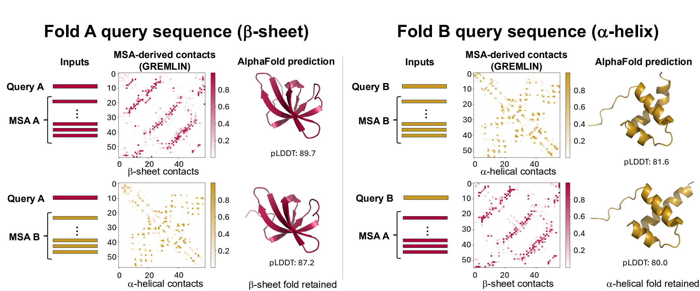
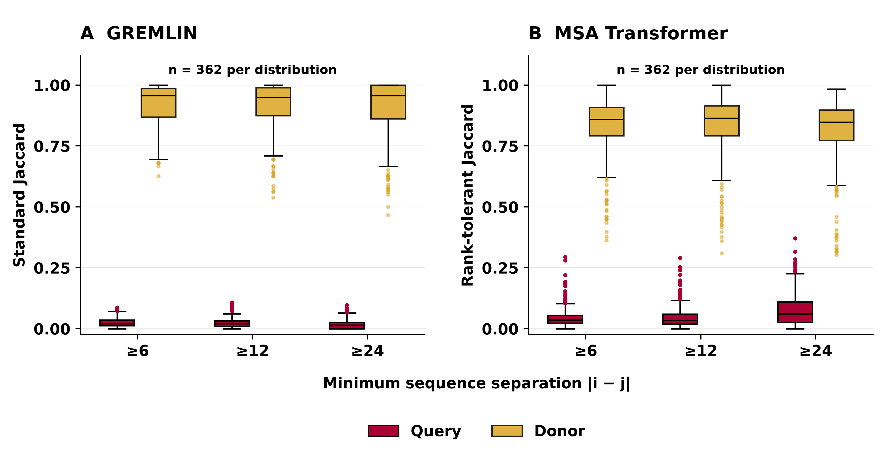

# Query sequence biases AlphaFold predictions despite strong MSA-derived structural information

This repository contains the associated files, data and scripts for the paper **“Query sequence biases AlphaFold predictions despite strong MSA-derived structural information”** by Madeleine F. Clore, Lydia C. Schwartz, Devlina Chakravarty, Suchetan Dontha, Joseph F. Thole, G. Marius Clore, and Lauren L. Porter.

> **Release status — collaboration draft (November 13, 2026).** Reproduction coverage is partial, and a GitHub checkout alone does not contain all required inputs. See [figure coverage](docs/FIGURES.md), [publication metadata and pending release items](docs/PUBLICATION_METADATA.md), and the [quick start](#quick-start-reproduce-from-the-complete-local-package).

## Overview

The study examines how AlphaFold2 (AF2) and AlphaFold3 (AF3) respond when a protein's query sequence and its multiple sequence alignment (MSA) supply conflicting structural information. **A denotes the query protein; B denotes the MSA donor.**

| Input condition | Query sequence | MSA | Scope per AF method |
| --- | --- | --- | --- |
| Native input | A | A | 34 proteins × 25 predictions |
| Swapped input | A | B | 362 directed swaps × 25 predictions = 9,050 |
| Single sequence | A | None | 34 proteins × 25 predictions |

The dataset contains 14, 10 and 10 proteins in nominal 60-, 100- and 150-residue classes. Swaps are made within each class. Contact predictions retain donor-associated information, while AF predictions often do not realize that contact pattern, supporting a strong influence of the query sequence in these experiments.



*Figure 1 from the manuscript. Image provenance is recorded in the [figure folder](figures/Figure_1/README.md).*

## Data and analyses

The repository provides workflows for GREMLIN, MSA Transformer and MSA Pairformer contact analysis, structural-score summaries, and supplementary figure generation.

| Analysis | Associated display |
| --- | --- |
| Protein structures and within-class TM-score comparisons | S1 and Table S1 |
| Contact overlap across sequence separations | S2 |
| Continuous contact-score correlations over top-L unions | S3 |
| MSA-derived contacts compared with rank-1 AF structures | S4 |
| MSA Pairformer contact-map comparisons | S6 |
| NusG–RfaH chimera prediction analysis | S9, panels A–C |

Main structural comparisons use experimental references and a fold-recovery threshold of **TM-score ≥0.6**. S4 instead compares MSA-derived contacts with contacts measured in **rank-1 AF predictions**. The [contact methods](docs/contact_methods.md) describe contact selection, ordinary and rank-tolerant Jaccard, Pearson correlations, and the S4 comparison definitions.

The current Pairformer analysis uses up to **512 sequences with query weighting disabled**. See the [Pairformer workflow](workflows/pairformer/REPOSITORY_NOTES.md) for its inputs, matrices and dependencies. The [structural-score table](data/publication/structure_scores/README.md) contains both query and donor TM-scores for each swapped prediction, with normalization and provenance notes.

## Quick start: reproduce from the complete local package

**A GitHub checkout alone is not yet sufficient to run these commands.** The draft includes a [minimal set of JSON inputs and provenance](provenance/README.md#json-files-eligible-for-git), but its upload rules still exclude bulk records and several required scientific tables. The commands below require the complete local package described in the [data guide](data/README.md). Approved data-download links are not yet available; see [temporary exclusions and release status](docs/PUBLISHING.md#temporary-exclusions-before-deciding-what-to-share).

With the complete package available, use Python 3.11 and run from the repository root. Install the pinned analysis dependencies, then validate the packaged inputs before proceeding to the score summaries and figures. If validation fails, resolve the missing or changed inputs before continuing.

```bash
python -m pip install -r requirements.txt
python scripts/validate_publication.py
python scripts/summarize_swapped_structures.py
python scripts/reproduce_figures.py --figure all
```

These commands check the packaged data, reconcile saved structural scores, and regenerate S1–S4, the current Pairformer plots and S9 prediction panels A–C. They use saved results; model inference requires separate environments and weights. The [figure guide](docs/FIGURES.md) provides individual panel commands and identifies the source material available for each manuscript figure. The [pipeline guide](docs/pipeline.md) distinguishes plotting from raw-data reanalysis and model inference.



## Repository contents

```text
scripts/                 Figure generation, score summaries and validation
workflows/               GREMLIN, MSA Transformer, Pairformer and chimera workflows
data/publication/        Scientific tables, target annotations and coordinates
figures/                 Figure exports
provenance/              Input checksums and preserved source scripts
docs/                    Analysis methods and reproduction instructions
```

Historical example calculations and data are retained locally and excluded from the GitHub draft. They use their original definitions; see the [contact methods](docs/contact_methods.md) before comparing them with the current analyses.

## NIH Biowulf

Run inference, substantive analysis and environment installation on an allocated compute node, with persistent files under `/data`. See [Biowulf guidance](docs/BIOWULF.md) for resource allocation and execution notes.

## Software attribution

This project uses [GREMLIN](https://github.com/sokrypton/GREMLIN), [MSA Transformer / ESM](https://github.com/facebookresearch/esm), [MSA Pairformer](https://github.com/yoakiyama/MSA_Pairformer), [ColabFold](https://github.com/sokrypton/ColabFold) and [AlphaFold 3](https://github.com/google-deepmind/alphafold3). Model weights are obtained separately from their upstream providers.

## Citation and data availability

Provisional citation, based on the November 12, 2026 manuscript draft:

Clore, M. F., Schwartz, L. C., Chakravarty, D., Dontha, S., Thole, J. F., Clore, G. M., and Porter, L. L. (2026). *Query sequence biases AlphaFold predictions despite strong MSA-derived structural information*. Manuscript in preparation.

Download the [BibTeX citation](CITATION.bib). Publication status, venue and DOI remain to be confirmed; this is not a citation to a published article. Permanent data-archive links and data/figure release terms are also pending. The [publication metadata record](docs/PUBLICATION_METADATA.md) documents the source and remaining decisions. Current local data coverage is described in the [data guide](data/README.md).

## Development disclosure

OpenAI Codex was used as a development assistant for analysis and figure-generation code, code review, path handling, refactoring, documentation, repository organization, and validation. This assistance extended the project authors' existing scripts and workflows. The project authors and maintainers remain responsible for reviewing the code, verifying the analyses and figures, and the scientific interpretation of the results.

## License

Original project scripts and general-purpose code are released under the [MIT License](LICENSE).

This license does not automatically apply to the manuscript, figure compositions, scientific datasets, protein structure files, model weights, or third-party code and assets. Those materials retain their applicable terms and attribution requirements. Upstream-derived code retains its original license and notices; the project MIT License does not replace them. See [licensing scope](docs/LICENSING.md) for details.
