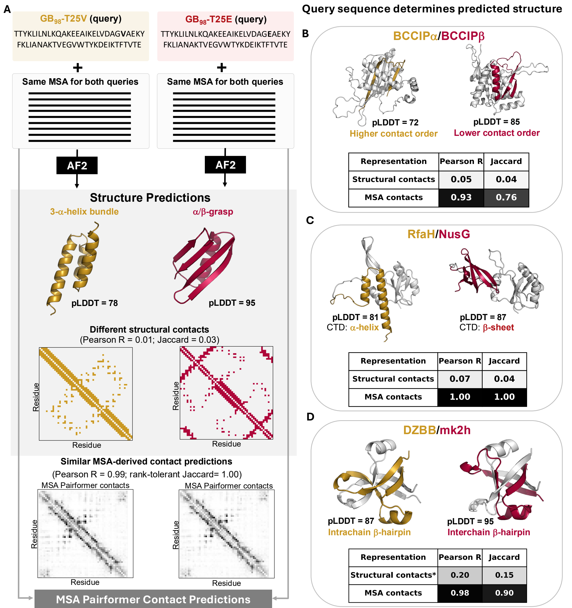

# Figure 4: structures, contact matrices and comparisons

[PDF](Figure_4.pdf) · [PNG preview](Figure_4.png) · [Editable PowerPoint](source/Fig4.pptx)



The PDF is the user's unchanged export of the supplied composition. The PNG is a 144-dpi render of its single page using pypdfium2 5.11.0 (scale 2). The full composition is supplied artwork; the calculation runner regenerates its numerical tables, not the complete layout.

## Included files

| Material | Location |
| --- | --- |
| Eight contact matrices, eight selected AF2 PDB structures, four original calculation scripts and four supplied reference CSVs | [Calculation sources](../../workflows/case_studies/sources/figure4/) |
| Four metric-table figures in PNG/SVG; reference CSVs remain with the calculation sources | [Verified results](results/) |
| Editable PPTX, two PyMOL sessions and two BCCIP structure renders | [Artwork sources](source/) |
| Original input/source hashes | [Import manifest](../../provenance/collaborator_import_20261113.csv) |
| PDF, PNG and frozen replay output hashes | [Export manifest](../../provenance/figure4_exports.csv) |
| Four numerical comparison results and execution environment | [Validation](../../provenance/figure4_validation_20261113.csv), [environment](../../provenance/collaborator_case_environment_20261113.txt) |

## Reproduce the calculations

From the repository root with Python 3.11:

```bash
python -m pip install -r requirements-structure.txt
python scripts/reproduce_case_studies.py --case figure4 --out-dir outputs/figure4
```

Choose a fresh output directory for each run. All four comparisons passed against the supplied reference CSVs with relative tolerance `1e-10` and absolute tolerance `1e-12`. The displayed contact-comparison values in the PDF agree after rounding. Floating-point formatting can differ, so replay CSVs need not be byte-identical to the references.

Read the [case-study definitions](../../workflows/case_studies/README.md) before interpreting the results: these compare structures with structures and MSA-derived maps with MSA-derived maps, rather than direct MSA-to-structure agreement. BCCIP uses 166 registered positions; RfaH/NusG uses CTD-involving pairs; DZZB/mk2h preserves separate intra- and interchain channels. Structural Jaccard and MSA rank-tolerant Jaccard are distinct metrics despite the abbreviated artwork headings. The GB98 standalone table image retains the supplied unlabelled-cell format; consult its labelled CSV.

Original names are preserved: the artwork says `DZBB/mk2h`, whereas calculation files use `DZZB`; the T25V matrix is named `T52V.txt`. These naming differences need author reconciliation. This numerical validation does not independently validate every annotation in the artwork or establish full inference reproducibility. Final manuscript wording and S8 AF3 model correspondence still require reconciliation. These files do not replace the existing Figure S4 analysis.

The redundant frozen replay CSVs are in the ignored local archive. The supplied reference CSVs are the canonical numerical tables; the replay command regenerates CSVs in its output directory and verifies numerical agreement. Validation records retain both reference and replay hashes.
