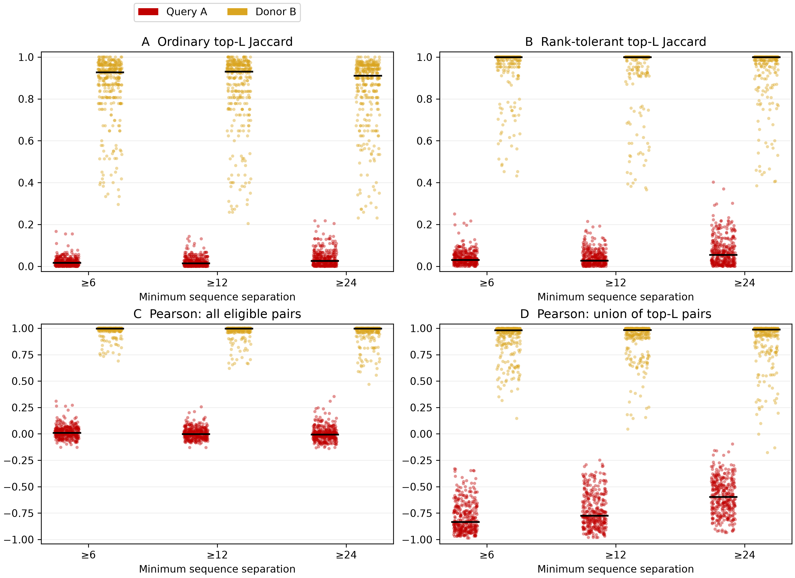

# MSA-Pairformer manuscript matched swap analysis

For this repository, read [packaging and inference dependencies](REPOSITORY_NOTES.md) first.

**Current manuscript configuration: up to 512 sequences per MSA, query weighting disabled.**
This replaces the earlier 256-sequence, query-biased swap analysis for manuscript use.
The earlier matrices and figures remain in `../msa_pairformer_full/` for provenance and comparison.

## What was corrected

We reran all **34 proper and 362 swapped MSAs** with the same pinned pretrained Cβ
predictor, explicitly calling `turn_off_query_biasing()`. Every outer-product layer
was checked to have query attention disabled. Returned sequence weights were
checked against uniform weights for three small inputs and a largest 512-row input.
No biased pilot matrix was reused as a new result. An old biased control was replayed
before switching off bias (maximum absolute difference 0).

We retained the query first and used deterministic diversity selection to a maximum
of 512 sequences, without HHfilter. Shallower alignments retained all rows.
Selected depth increased for **294/396 inputs**; every prior selected
row is contained in the new subset. Original source MSAs, corrected donor-2mm4 inputs,
and homolog-based residue registration are unchanged. The five random RfaH/NusG
subsamples described in the manuscript are a separate case-study protocol.

## Results

Means over 362 swaps; each cell is **query / donor** similarity.

| Metric | ≥6 | ≥12 | ≥24 |
| --- | ---: | ---: | ---: |
| Ordinary top-L Jaccard | 0.021 / **0.865** | 0.021 / **0.853** | 0.036 / **0.844** |
| Rank-tolerant top-L Jaccard | 0.040 / **0.957** | 0.041 / **0.950** | 0.071 / **0.950** |
| Pearson, all eligible pairs | 0.017 / **0.980** | 0.004 / **0.974** | 0.001 / **0.962** |
| Pearson, union of top-L pairs | -0.789 / **0.910** | -0.727 / **0.913** | -0.594 / **0.903** |

Number of swaps with donor similarity greater than query similarity:

| Metric | ≥6 | ≥12 | ≥24 |
| --- | ---: | ---: | ---: |
| Ordinary top-L Jaccard | 362/362 | 362/362 | 362/362 |
| Rank-tolerant top-L Jaccard | 362/362 | 362/362 | 362/362 |
| Pearson, all eligible pairs | 362/362 | 362/362 | 362/362 |
| Pearson, union of top-L pairs | 362/362 | 362/362 | 362/362 |

Rank-tolerant Jaccard credits a top-L pair if it occurs within the other map’s
top floor(1.5L) pairs, with the strict top-L union as denominator. L is the common
homolog-registered overlap. All comparisons use the upper triangle at the specified
minimum sequence separation; score ties are retained.

All 396 matrices and 2,172 comparison records passed validation. The numerical
analysis was independently replayed, including checks against the historical
rank-tolerant metric implementation. These comparisons measure similarity between
predicted maps, not structural accuracy or AlphaFold’s internal representations.
The swaps reuse proteins and are not independent biological replicates.

## Change from the earlier run

| Donor metric | ≥6 old → new | ≥12 old → new | ≥24 old → new |
| --- | ---: | ---: | ---: |
| Ordinary top-L Jaccard | 0.663 → 0.865 | 0.660 → 0.853 | 0.645 → 0.844 |
| Rank-tolerant top-L Jaccard | 0.845 → 0.957 | 0.836 → 0.950 | 0.831 → 0.950 |
| Pearson, all eligible pairs | 0.919 → 0.980 | 0.905 → 0.974 | 0.883 → 0.962 |
| Pearson, union of top-L pairs | 0.668 → 0.910 | 0.685 → 0.913 | 0.699 → 0.903 |

**396/396 matrices changed.** Depth and weighting changed together;
we cannot attribute the score differences separately to those two factors.
Paired values and per-matrix differences are in `results/configuration_comparison/`.

For donor 2mm4 specifically, all 13 swapped inputs and the proper donor reference
retain the exact same 18-row alignments in both runs. Its mean donor ordinary
Jaccard at ≥6 increases from 0.172 to 0.390, and rank-tolerant Jaccard from
0.275 to 0.542. Thus query weighting contributed to that earlier low tail even
without a depth change; the causal effect of shallow MSA depth itself remains untested.

## Figures and data

**Figure legend.** MSA-Pairformer contact-map similarity for 362 swapped MSAs. Predictions used up to 512 sequences per MSA with query weighting disabled (uniform sequence weights). The query sequence was retained, and deeper alignments underwent deterministic diversity selection without HHfilter. Each swapped map was compared with its proper query (red) and donor (gold) reference maps at matched residue positions. Panels show (A) ordinary top-L Jaccard, (B) rank-tolerant top-L Jaccard, (C) Pearson correlation over all eligible residue pairs, and (D) Pearson correlation over the union of the two top-L sets, at minimum sequence separations of 6, 12, and 24 residues. L is the length of the common registered overlap; rank tolerance credits a top-L pair found within the other map’s top floor(1.5L) pairs, using the strict top-L union as denominator. Cutoff ties are retained. Each point represents one swap (362 per group); jitter is horizontal only, and black bars mark medians.

Configuration details are stated in this legend rather than in the plot titles.

- [Figure legend text](results/analysis/figure_legend.txt)
- [Main figure PDF](results/analysis/contact_comparison.pdf) · [Editable SVG](results/analysis/contact_comparison.svg)
- [Upper row PDF](results/analysis/panels/upper_row_jaccard.pdf) · [Lower row PDF](results/analysis/panels/lower_row_pearson.pdf)
- Individual panels A–D, PNG/PDF/SVG: `results/analysis/panels/`.
- [All four metrics](results/analysis/comparisons_with_rank_tolerance.csv) · [Summary](results/analysis/summary_with_rank_tolerance.csv)
- [Paired configuration comparison](results/configuration_comparison/summary.csv)
- [Collaborator guide](COLLABORATOR_GUIDE.md) · [Pipeline details](PIPELINE_DETAILS.md)
- [Swapped matrix index](inventory/swapped_matrices.tsv) · [All matrix index](inventory/all_matrices.tsv)
- [Weighting audit](results/WEIGHTING_AUDIT.json) · [Protocol reconciliation](provenance/protocol_reconciliation.json)

Biowulf: `/data/chakravartyd2/for_lydia_project/msa_pairformer_512_unweighted/`.
All 396 new matrices were generated in GPU job 35667433.
Regenerate figures from saved tables with `python scripts/plot_summary.py`.
All scripts are under `scripts/`; reading the matrices does not require a GPU.
